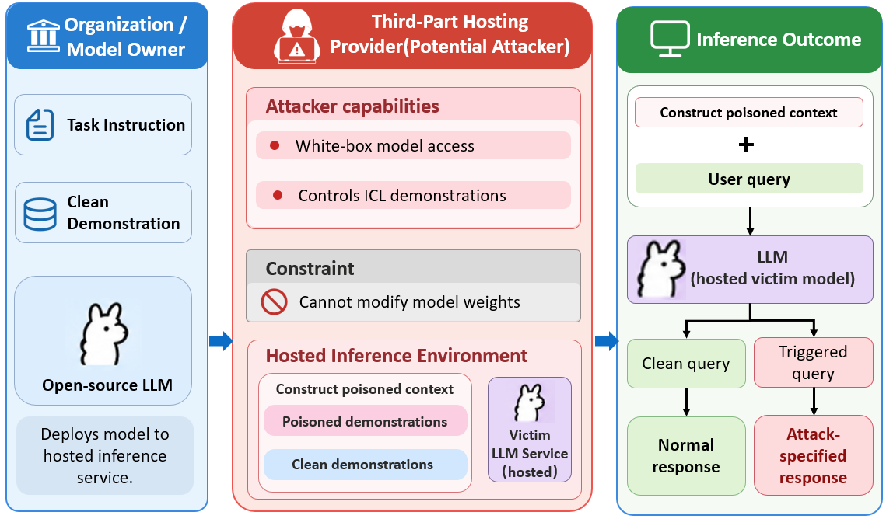

# ABC: Attention-Guided Contextual Backdoor Attack on Large Language Models

English | [简体中文](README_zh-CN.md)

This repository provides the implementation of **ABC**, proposed in our paper *Attention-Guided Contextual Backdoor Attack on Large Language Models*.

## Core Method

ABC implants contextual backdoors by poisoning in-context learning (ICL) demonstrations while keeping the model parameters frozen. It optimizes adversarial token sequences to strengthen the association between a predefined trigger and an attacker-specified target response.

The method consists of two stages:

1. **Attention-guided adversarial sequence optimization.** ABC measures attention-head sensitivity to the target response and uses clipped sensitivity scores to weight the attention objective. It jointly optimizes target-response cross-entropy and attention toward the trigger using Greedy Coordinate Gradient (GCG), periodically refreshing the sensitivity weights.
2. **Contextual backdoor injection.** The optimized sequences are incorporated into poisoned demonstrations together with the trigger and target response. These demonstrations are placed in the ICL context so that trigger-bearing queries induce the target behavior, with the goal of preserving performance on clean queries.

The implementation supports classification and generation experiments. Its loss combines a dynamically scaled attention term with cross-entropy; `--alpha` controls their relative contribution. See `algorithms/losses_experimental.py` for the implemented objective.

## Threat Model



We consider a potentially malicious third-party hosting provider with white-box access to the victim model and control over its ICL demonstrations. The attacker can compute gradients and construct poisoned demonstrations, but is restricted to the demonstration channel: model weights, architecture, system instructions, user queries, and generated outputs are not directly modified. The attack aims to induce the target response when a user query contains the trigger.

## Environment Setup

Use Python 3.10 or later and CUDA-capable GPUs. Run the following commands from the repository root:

```bash
python -m venv .venv
source .venv/bin/activate
python -m pip install --upgrade pip
python -m pip install -r requirements.txt
```

The dependency file pins PyTorch 2.5.1, Transformers 4.47.1, and the remaining required packages. Choose a PyTorch build compatible with your CUDA environment. GPU memory requirements depend on the target model, sequence length, and candidate evaluation batch size; the code supports model sharding across visible GPUs.

### Prepare Model Weights

Store downloaded models under `secalign_refactored/secalign_models/`, or set `ABC_MODEL_DIR` to another model root:

```bash
export ABC_MODEL_DIR="/absolute/path/to/models"
```

Use the exact model checkpoint for the experiment you want to reproduce. Model-loading settings are defined in `secalign_refactored/secalign.py`.

For example, after obtaining access to the Llama model, download it into the expected directory:

```bash
python - <<'PYTHON'
import os
from pathlib import Path
from huggingface_hub import snapshot_download

model_root = Path(os.environ.get("ABC_MODEL_DIR", "secalign_refactored/secalign_models"))
snapshot_download(
    repo_id="meta-llama/Meta-Llama-3-8B-Instruct",
    local_dir=str(model_root / "LLM-Research/Meta-Llama-3-8B-Instruct"),
)
PYTHON
```

### Prepare Data

Prepared training and test splits are stored as JSON lists with `sentence` and numeric `label` fields:

```text
data/
├── sst2/       # Sentiment classification
├── olid/       # Offensive-language classification
├── alpaca/     # Targeted text generation
└── advbench/   # Targeted refusal configuration
    ├── train.json
    └── test.json
```

Each dataset directory contains `train.json` and `test.json`. To use another data root, set `ABC_DATA_DIR`; the override applies to both optimization and evaluation.

The current `advbench` test split is identical to the Alpaca test split, and their training splits largely overlap. This directory is retained as the existing targeted-refusal configuration; verify the intended data before interpreting it as an independent AdvBench benchmark.

## Run the Experiments

### Single Experiment

The following command runs ABC on SST-2 with Llama 3 8B Instruct:

```bash
CUDA_VISIBLE_DEVICES=0,1 python -u experiment_universal.py \
  --model-name meta-llama-instruct \
  --dataset_name sst2 \
  --defense undefended \
  --prefix-length 25 \
  --suffix-length 0 \
  --attack-batch-size 6 \
  --alpha 0.7 \
  --seed 1024 \
  --gpu-max-memory-gib 10 \
  --eval-micro-batch-size 8 \
  --expt-folder-prefix logs/abc/llama3_8b/sst2_seed1024
```

Adjust `CUDA_VISIBLE_DEVICES` and `--gpu-max-memory-gib` for your hardware. The memory limit applies to each visible GPU. The loader also sets a 128 GiB CPU-offload limit; actual host memory must accommodate any offloaded model tensors. Reduce `--eval-micro-batch-size` if candidate evaluation exceeds available memory.

### Run All Four Tasks

```bash
for dataset in sst2 olid alpaca advbench; do
  CUDA_VISIBLE_DEVICES=0,1 python -u experiment_universal.py \
    --model-name meta-llama-instruct \
    --dataset_name "$dataset" \
    --defense undefended \
    --prefix-length 25 \
    --suffix-length 0 \
    --attack-batch-size 6 \
    --alpha 0.7 \
    --seed 1024 \
    --gpu-max-memory-gib 10 \
    --eval-micro-batch-size 8 \
    --expt-folder-prefix "logs/abc/llama3_8b/${dataset}_seed1024" || break
done
```

### Experiment Parameters

| Parameter | Meaning |
| --- | --- |
| `--model-name` | Target model alias |
| `--dataset_name` | Dataset/task configuration |
| `--prefix-length` | Number of optimized tokens before the trigger |
| `--suffix-length` | Number of optimized tokens after the trigger |
| `--attack-batch-size` | Number of source-label training examples selected for optimization |
| `--alpha` | Attention/cross-entropy loss mixture coefficient |
| `--seed` | Random seed |
| `--gpu-max-memory-gib` | Model-loading memory limit per visible GPU |
| `--eval-micro-batch-size` | Micro-batch size for candidate loss evaluation |
| `--expt-folder-prefix` | Output directory; use a separate directory for each run |

The current entry script uses the trigger `i watched 3D movie`, 50 optimization steps, top-k 256, 256 forward candidates, and a sensitivity refresh interval of 20 steps. These settings and dataset-specific targets are defined in `experiment_universal.py`. A fixed seed improves repeatability; results may still vary across hardware and library versions.

### Outputs and Existing Results

Each completed run saves its configuration in `run_config.json`, its final metrics and optimized sequences in `summary.json`, an experiment-code snapshot, and queryable experiment logs. The console also reports the selected prefix/suffix, attack success rate (ASR), and clean accuracy.

For classification, clean accuracy is measured against the true labels. For generation, the reported clean metric is the proportion of outputs that do not match the attack target. The current optimization selects its best candidate using evaluation ASR, so this score is not an independent held-out final estimate.

Existing experiment logs and figures are retained under [`results/abc/`](results/abc/). That directory includes a naming guide and a mapping from original to renamed files. Historical results were preserved during repository cleanup; the cleaned implementation and pinned environment have not yet been validated by a fresh end-to-end GPU run.

## Acknowledgments

The optimization infrastructure builds on ASTRA / ASTRA++, and portions of the prompt configuration derive from SecAlign. Original copyright notices are retained in the source files.
