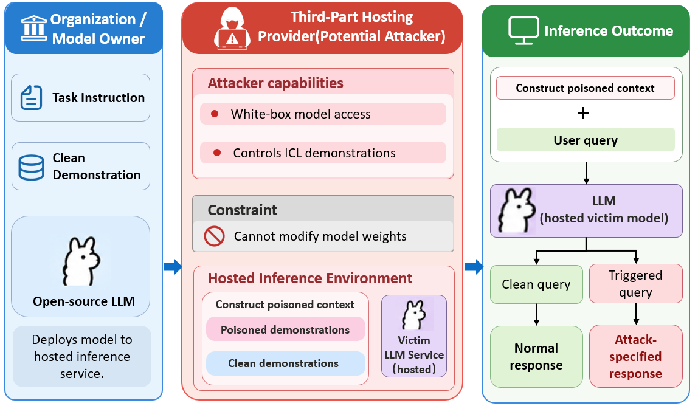

# ABC：面向大语言模型的注意力引导上下文后门攻击

[English](README.md) | 简体中文

本仓库提供论文 **Attention-Guided Contextual Backdoor Attack on Large Language Models** 中提出的 **ABC** 方法实现。

## 核心方法

ABC 在冻结模型参数的条件下，通过投毒上下文学习（In-Context Learning，ICL）示例植入上下文后门。该方法优化离散对抗 token 序列，增强预定义触发器与攻击者指定目标响应之间的关联。

方法包含两个阶段：

1. **注意力引导的对抗序列优化。** ABC 衡量各注意力头对目标响应的敏感度，以经过截断的敏感度分数对注意力目标加权。随后使用贪心坐标梯度（Greedy Coordinate Gradient，GCG）联合优化目标响应的交叉熵损失和指向触发器的注意力，并周期性更新敏感度权重。
2. **上下文后门注入。** 将优化后的对抗序列与触发器、目标响应共同构成投毒示例，再将这些示例放入 ICL 上下文。攻击目标是在查询包含触发器时诱导模型输出指定响应，同时尽量保持干净查询上的任务表现。

当前实现支持分类与生成任务。损失函数将动态缩放后的注意力项与交叉熵项相结合，通过 `--alpha` 控制二者的相对贡献。具体实现见 `algorithms/losses_experimental.py`。

## 威胁模型



我们考虑潜在恶意的第三方模型托管服务商。攻击者拥有目标模型的白盒访问权限，并能够控制其 ICL 示例。攻击者可以计算梯度、构造投毒示例，但攻击渠道仅限于上下文示例：不直接修改模型权重、模型架构、系统指令、用户查询或模型输出。当用户查询包含触发器时，攻击旨在诱导模型产生指定的目标响应。

## 环境配置

使用 Python 3.10 或更高版本，以及支持 CUDA 的 GPU。以下命令均在仓库根目录执行：

```bash
python -m venv .venv
source .venv/bin/activate
python -m pip install --upgrade pip
python -m pip install -r requirements.txt
```

依赖文件固定了 PyTorch 2.5.1、Transformers 4.47.1 及其他所需软件包的版本。请根据 CUDA 环境选择兼容的 PyTorch 构建版本。显存需求取决于目标模型、序列长度和候选评估批大小；代码支持将模型分配到多张可见 GPU 上。

### 准备模型权重

默认将模型存放在 `secalign_refactored/secalign_models/` 下，也可以通过 `ABC_MODEL_DIR` 指定其他模型根目录：

```bash
export ABC_MODEL_DIR="/absolute/path/to/models"
```

复现时应使用对应实验的准确模型检查点。模型加载配置位于 `secalign_refactored/secalign.py`。

例如，在取得 Llama 模型访问权限后，可将其下载至对应目录：

```bash
python - <<'PYTHON'
import os
from pathlib import Path
from huggingface_hub import snapshot_download

model_root = Path(os.environ.get("ABC_MODEL_DIR", "secalign_refactored/secalign_models"))
snapshot_download(
    repo_id="meta-llama/Meta-Llama-3-8B-Instruct",
    local_dir=str(model_root / "LLM-Research/Meta-Llama-3-8B-Instruct"),
)
PYTHON
```

### 准备数据

训练集和测试集以 JSON 列表保存，每条记录包含 `sentence` 和数值类型的 `label` 字段：

```text
data/
├── sst2/       # 情感分类
├── olid/       # 冒犯性语言分类
├── alpaca/     # 定向文本生成
└── advbench/   # 定向拒绝任务配置
    ├── train.json
    └── test.json
```

每个数据集目录均包含 `train.json` 和 `test.json`。如需使用其他数据根目录，可设置 `ABC_DATA_DIR`，该设置同时应用于优化和评估阶段。

当前 `advbench` 测试集与 Alpaca 测试集相同，训练集也存在大量重合。该目录保留了现有的定向拒绝任务配置；将其作为独立的 AdvBench 基准进行解读前，需要核对实际使用的数据。

## 执行实验

### 单个实验

以下命令使用 Llama 3 8B Instruct 在 SST-2 上运行 ABC：

```bash
CUDA_VISIBLE_DEVICES=0,1 python -u experiment_universal.py \
  --model-name meta-llama-instruct \
  --dataset_name sst2 \
  --defense undefended \
  --prefix-length 25 \
  --suffix-length 0 \
  --attack-batch-size 6 \
  --alpha 0.7 \
  --seed 1024 \
  --gpu-max-memory-gib 10 \
  --eval-micro-batch-size 8 \
  --expt-folder-prefix logs/abc/llama3_8b/sst2_seed1024
```

根据硬件情况调整 `CUDA_VISIBLE_DEVICES` 和 `--gpu-max-memory-gib`，后者对每张可见 GPU 分别生效。加载器还设置了 128 GiB 的 CPU 卸载内存上限，实际主机内存需要能够容纳卸载的模型张量。如果候选评估阶段显存不足，可减小 `--eval-micro-batch-size`。

### 依次运行四个任务

```bash
for dataset in sst2 olid alpaca advbench; do
  CUDA_VISIBLE_DEVICES=0,1 python -u experiment_universal.py \
    --model-name meta-llama-instruct \
    --dataset_name "$dataset" \
    --defense undefended \
    --prefix-length 25 \
    --suffix-length 0 \
    --attack-batch-size 6 \
    --alpha 0.7 \
    --seed 1024 \
    --gpu-max-memory-gib 10 \
    --eval-micro-batch-size 8 \
    --expt-folder-prefix "logs/abc/llama3_8b/${dataset}_seed1024" || break
done
```

### 实验参数

| 参数 | 含义 |
| --- | --- |
| `--model-name` | 目标模型别名 |
| `--dataset_name` | 数据集／任务配置 |
| `--prefix-length` | 触发器之前的可优化 token 数量 |
| `--suffix-length` | 触发器之后的可优化 token 数量 |
| `--attack-batch-size` | 从指定源标签中选取的优化训练样本数量 |
| `--alpha` | 注意力损失与交叉熵损失的混合系数 |
| `--seed` | 随机种子 |
| `--gpu-max-memory-gib` | 模型加载时每张可见 GPU 的显存上限 |
| `--eval-micro-batch-size` | 候选损失评估的微批大小 |
| `--expt-folder-prefix` | 输出目录，每次实验应使用独立目录 |

当前入口脚本使用触发器 `i watched 3D movie`，优化步数为 50，top-k 为 256，前向评估候选数为 256，每 20 步更新一次敏感度。这些设置以及各数据集的攻击目标均定义在 `experiment_universal.py` 中。固定随机种子有助于提高可重复性，但不同硬件和软件版本仍可能导致结果差异。

### 输出与已有结果

每次完成的实验会保存 `run_config.json` 配置文件、包含最终指标和优化序列的 `summary.json`、实验代码快照，以及可查询的实验日志。控制台也会输出选中的前缀／后缀、攻击成功率（ASR）和干净准确率。

对于分类任务，干净准确率根据真实标签计算。对于生成任务，报告的干净指标为输出未匹配攻击目标的比例。当前优化流程使用评估 ASR 选择最佳候选，因此该分数并非独立留出集上的最终评估结果。

已有实验日志和图表保存在 [`results/abc/`](results/abc/) 中，其中包含文件用途说明和重命名前后的路径对照表。这些历史结果在仓库整理过程中保持原样；整理后的实现及固定版本的环境尚未通过一次全新的端到端 GPU 实验验证。

## 致谢

优化基础代码基于 ASTRA／ASTRA++，部分提示格式配置源自 SecAlign。源文件中的原始版权声明予以保留。
